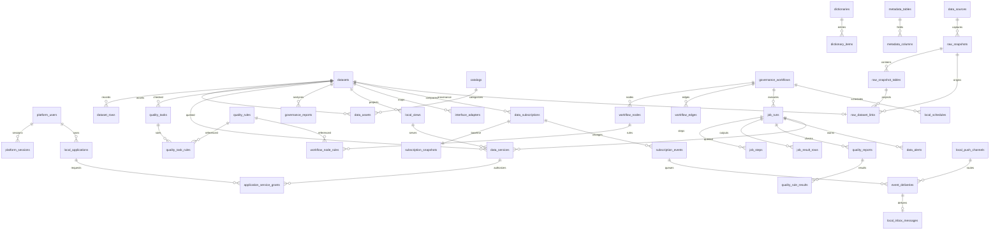

# 治理平台数据库设计

版本3.4.0，当前结构版本3。平台文件默认.data-v3/platform.sqlite3，依次执行db/schema.sql、schema-v2.sql及schema-v3.sql。8类数据库只读采集另存到.data-v3/raw，每批一个独立SQLite逻辑快照；训练服务器不执行DDL/DML。

## 数据覆盖与关系

平台共49张表：基础33张、版本2扩展13张、版本3采集相关3张；每份独立原始库另有raw_tables/raw_rows/manifest三张表。

| 类别 | 数据表 |
| --- | --- |
| 身份与配置 | schema_migrations、platform_settings、platform_users、platform_sessions |
| 标准与项目 | projects、business_types、data_elements、qualifiers、dictionaries、dictionary_items、catalogs |
| 数据与资产 | data_sources、datasets、dataset_rows、data_assets、metadata_tables、metadata_columns |
| 流程 | governance_workflows、workflow_nodes、workflow_edges、workflow_node_rules |
| 检测与管理 | quality_rules、quality_tasks、quality_task_rules、alert_policies |
| 执行结果 | job_runs、job_steps、quality_reports、quality_rule_results、job_result_rows |
| 服务与追踪 | data_services、data_alerts、audit_logs |
| 对标与审核 | governance_reports、governance_approvals |
| 调度与视图 | local_schedules、local_views |
| 应用与授权 | local_applications、application_service_grants |
| 接口与通道 | interface_adapters、local_push_channels |
| 订阅与消息 | data_subscriptions、subscription_snapshots、subscription_events、event_deliveries、local_inbox_messages |
| 原始库与来源 | raw_snapshots、raw_snapshot_tables、raw_dataset_links |

所有主业务记录保留原ID（TEXT），子项使用所属ID+顺序/节点ID的复合主键，避免不同流程共用n1等节点ID时冲突。核心名称、状态、来源、时间及关联字段有独立列，配置扩展字段保存在payload_json。任意字段的数据记录逐行保存在data_json，不是整库JSON快照。

## 约束与索引

- 名称和必要状态不能为空；用户角色、节点类型、运行状态、预警状态有CHECK约束。
- 账号名称唯一，会话主键为令牌SHA-256哈希。口令为原scrypt哈希，服务密钥仅存哈希。
- 外键开启：配置、数据集、规则、目录等被引用时禁止删除，所属节点、连线、字典项、字段和结果行随主项级联删除。
- 历史运行保留名称、流程/任务标识快照；流程或任务删除时SQL关联列置空，仍可读取历史报告。
- 预警关联运行，服务关联数据集、成功运行或本地视图。版本2为data_services增加view_id，引用视图时禁止删除视图。
- 会话有效期、运行时间/状态、资源关联、服务发布状态、预警状态/时间、审计时间/动作有索引。

workflow_nodes配置和workflow_node_rules保留现有接口格式；后者对实际保存的规则引用施加外键约束。内联质量规则仍保存在节点参数中。质量报告的规则ID是历史快照，不受现行规则删除影响。

## 保存与读取

API调用Store方法进行参数化SQL读写，不维护state内存镜像，不更新旧state.json。实体保存、嵌套子项替换、运行步骤/报告/结果使用事务；失败全部回滚。任务完成后的结果、预警和审计一起提交。所有SQLite连接访问受线程锁保护，WAL、10秒锁等待、FULL同步和外键启用。

列表的现有分页/搜索API兼容保留；部分分页仍在服务层组装后完成，当前不是大数据量查询平台。流程输入上限10,000行，单进程最多2个并发执行进程。限流计数、登录尝试和活动进程保持内存，业务记录与会话入库。

## 初始化与迁移

首次存在state.json时，先备份到backups，随后单事务按依赖顺序导入：用户、数据集、基础标准、规则、流程与任务、资产/元数据、运行、服务、预警和审计。核对每类配置、用户、运行、预警、审计及两类记录行数量后写迁移标记。失败回滚，可以修复原JSON后重试；成功后不再读取原JSON。

没有旧JSON时沿用内置示例。初始化不会自动导入旧Node的.data。既有主键、哈希和历史内容保留，新增数据库会话8小时有效并跨重启保存。

schema_migrations登记结构版本。新增表或列要建立新版本迁移；不能删除已有数据库或反复导入旧JSON替代升级。

### 版本2迁移与业务状态

启动先执行基础DDL，再幂等创建13张扩展表；检查data_services列后按需增加view_id外键，最后写结构版本2。重复启动不重复导入或清空数据。升级测试已使用带原有数据的版本1数据库核验。

扩展主表同样具有id/name/created_at/updated_at/payload_json；外键、启停、状态、间隔等独立列由固定表/字段映射管理。审批目标为多类型对象，以target_kind/target_id定位，保留不随目标删除消失的历史快照；版本指纹校验在业务事务内执行。分析报告可保存原配置、指标、实际明细及输出数据集关联；源数据删除后dataset_id置空，报告保留历史内容。

| 关系或状态 | 约束 |
| --- | --- |
| schedule→workflow | RESTRICT；last_run_id删除后置空 |
| view/adapter/subscription→dataset | RESTRICT |
| app→user | RESTRICT；归属账号须存在 |
| grant→app/service | CASCADE；同一应用/服务只允许一条pending或approved记录（部分唯一索引） |
| subscription→channel | 删除通道时SET NULL；仍有投递记录引用通道时RESTRICT |
| snapshot/event→subscription | CASCADE |
| delivery→event | CASCADE；同一事件/通道唯一 |
| inbox→delivery | CASCADE且UNIQUE，确保重复投递不重复入箱 |
| approval | pending/approved/rejected/withdrawn |
| grant | pending/approved/rejected/revoked |
| delivery | pending/delivered/failed |

调度和订阅以enabled/next_run_at建立到期索引，间隔至少60秒。后台仅在单实例进程存活期间推进状态；重启保留启停状态并读取到期任务，不补发所有错过的周期。投递失败保留错误及尝试次数，修复通道后可重试。业务事件按insert/update/delete类别保存变化详情，不连接外部消息系统。

## 运维

### 原始库结构与版本3

raw_snapshots以source_id关联data_sources（RESTRICT），保存状态、来源参数快照、进度、实际行数、采集时间及错误，不保存连接密码。raw_snapshot_tables保存模式名/表名/列原类型/可空性/主键/实际行数/逐行文本SHA-256，批次内表名唯一。raw_dataset_links以dataset_id为主键，关联原始批次与表（RESTRICT），副本删除时来源关联CASCADE。

每批采集先写`raw/<UUID>.partial`，原始库内raw_tables保存表结构JSON，raw_rows以(table_id,row_index)索引保存每条记录原值JSON；非NULL值保留连接器文本表示，原类型单独保存，二进制base64；MongoDB为完整Canonical Extended JSON文档。全部表读完并校验后原子重命名为.sqlite3，平台状态置SUCCESS。未完成快照不对治理开放。逻辑快照不复制索引、触发器、序列、权限或函数，不作为源数据库物理恢复备份。

版本3.4扩展8种采集连接器，复用原表结构，无新增DDL或清空数据操作。data_sources保存对应连接器的公开参数；raw_snapshots保留来源类型、参数快照及实际只读/一致性信息。严格快照与尽力读取按连接器能力校验，见[兼容矩阵](数据库兼容矩阵.md)。平台仓储和独立原始文件仍为SQLite。

原始库无编辑或覆盖API，本地读文件用mode=ro。新采集生成新版本，旧治理副本继续追溯旧批次。后台服务端游标分批读入，无10000行的原始采集截断；当前治理工作副本独立限制10000行/100字段，可保存明确的字段与行范围。

管理命令：npm run db:init、db:status、db:check、db:backup。init需停止服务，其他三项不会改运行状态。backup使用SQLite在线备份API，目标存在时拒绝覆盖；完整性和外键验证结果应为ok和空列表。

恢复建议使用新的GOV_DATA_DIR，把已验证备份命名platform.sqlite3，停止旧服务后切换。保留原目录和迁移前JSON备份。不要复制运行中的主文件而遗漏WAL。

版本3的db:backup还读取已备份平台数据库中的SUCCESS批次清单，将不可变原始文件复制到同名`.raw`目录。恢复时这些文件须放入新GOV_DATA_DIR/raw/；只恢复平台文件不包含原始记录。缺失原始文件或复制失败会报备份失败。

SQLite为当前实际运行仓储。db/schema-postgresql.sql仅为历史版本1模型的独立PostgreSQL建表参考，未包含版本2扩展；当前后端尚未实现PostgreSQL平台仓储，不要在训练库执行。

## 历史本地验收及本轮采集

版本3.2本地验收已保留原账号、3条规则、5节点4连线流程、8行数据集、7行历史结果及2条预警，与备份一致。本轮升级至49表、结构版本3，并保留这些原记录；新增真实PostgreSQL数据源、238表/96,739行原始快照、276行考试治理副本、4条质量规则及成功治理运行。本轮操作仅写本地平台及原始库，远程只查询。平台完整性/外键、原始库与备份均已检查，详见[采集验收](数据库采集验收-2026-10-15.md)。
