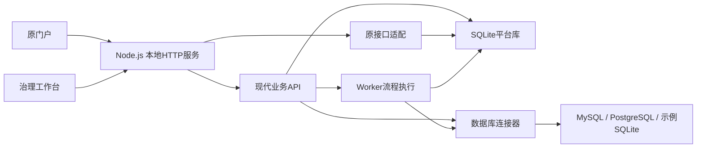

# 项目启动与前后端分析

检查日期：2026-10-14。范围：当前本地源码、运行服务、录制接口清单和隔离自动测试。此报告描述本次检查状态，不代表原厂完整产品能力。

## 1. 启动结果与总体判断

- 原平台首页：http://127.0.0.1:4173/home
- 新增治理工作台：http://127.0.0.1:4173/workbench
- 服务检查：http://127.0.0.1:4173/api/health
- 使用 Node.js 22.14.0，当前为 live 真实后端模式，仅监听本机。
- 11项自动测试全部通过；24个新后端读取接口实测均返回200。
- 本机3306端口存在MySQL服务，但平台当前仅登记一个SQLite示例数据源，没有登记MySQL数据源。本次没有完成真实MySQL连接、查询或写入验证。

项目已经具备一个可运行的数据治理后端及工作台。原厂门户是编译资源复现，原厂业务接口只部分适配，不能把原菜单全部理解为已完成的功能。

## 2. 这是一个什么平台

原页面品牌为“环食药数据生态”，定位是“一站式全链路数据中台”。菜单涉及数据接入、数据标准、数据资产、数据开发、数据质量、数据服务和平台管理。数据质量治理只是其中一部分。

完整产品应形成“接入业务数据库 → 采集元数据 → 定义标准与质量规则 → 编排处理流程 → 执行检测与清洗 → 发布资产及数据服务 → 监控和追踪”的闭环。当前本地版本实现了其中的基础闭环，没有还原所有原厂模块。

## 3. 前端结构

| 部分 | 实现与职责 | 当前情况 |
| --- | --- | --- |
| 原门户及子应用 | Vue 2、Vue Router、Vuex、Axios、qiankun、ECharts和原厂组件 | 从录制清单与编译资源提供页面；完整Vue业务源码缺失，部分懒加载资源缺失 |
| 新治理工作台 | `public/workbench/` 原生HTML、CSS、JavaScript | 有可编辑源码，承担数据库接入、拖拽编排、执行报告、规则、资产、服务及账号操作 |
| 登录桥接 | `public/workbench/session.js` | 为原页面建立真实本机会话；原录制token不能代表后端授权 |
| 子应用入口桥接 | `/sjjr/`、`/ztgl/` | 使用兼容入口嵌入工作台接入页和账号页 |
| 另一套静态包 | `public/static/js` 中的党建、RuoYi风格资源 | 不参与当前数据治理主门户，不能按它的`/dev-api`判断本项目后端 |

浏览器已验证原首页加载出品牌、管理员、任务统计及标准统计，新工作台也可加载。页面打开并不等于所有按钮或弹窗业务完整。

## 4. 后端结构与数据保存

| 文件 | 职责 |
| --- | --- |
| `server.mjs` | HTTP启动、原页面静态资源、新工作台、真实后端或显式回放模式 |
| `backend/service.mjs` | 登录、角色检查、资源CRUD、运行调度、数据服务发布和接口分发 |
| `backend/legacy.mjs` | 将部分原厂接口转换成本地配置、元数据及执行结果 |
| `backend/store.mjs` | SQLite持久化、口令加密、用户、会话、任务、结果、审计 |
| `backend/connectors.mjs` | SQLite、MySQL、PostgreSQL连接、表字段读取、分页查询、新表输出 |
| `backend/engine.mjs` | 流程结构校验、字段处理、去重、过滤、质量规则执行 |
| `backend/job-worker.mjs` | 独立Worker执行任务，反馈进度、成功或失败 |
| `backend/seed.mjs` | 初始化本地示例库、标准、规则、流程和管理员 |

平台管理数据保存到`.data/platform.sqlite`，包括settings、entities、users、sessions、runs、run_rows、audit。entities以kind/id及JSON内容保存13类资源，属于轻量通用配置模型，并非完整企业级关系模型。业务MySQL是外接的数据源，不是当前平台配置的存储库。

数据库口令采用AES-256-GCM加密，密钥在`.data/secret.key`；密码采用scrypt，会话令牌哈希保存。重启保留配置及历史结果。备份需要完整`.data`和密钥，不能只备份一个数据库文件。

## 5. 拖拽治理如何真正执行

拖拽负责生成nodes/edges流程定义；点击执行后，后端校验连接关系并交给Worker读取真实数据和执行规则。可用节点为读取、字段映射、清洗、过滤、去重、质量检测、输出。

质量规则包含非空、唯一、正则、数值范围和允许值集合。质量检测默认记录问题，不自动删除问题记录；需配置dropInvalid才过滤。

当前持久化示例运行成功，8条输入，经去重输出7条，质量检测发现2条问题记录。这个结果来自本地SQLite示例，不是MySQL业务验证。

执行边界：一个数据源、一个输出、线性流程，不支持分支、循环或多表合并；最多10,000条输入、默认45秒、最多两个并发任务。处理在JavaScript内存中进行，没有Flink、Spark或完整SQL下推引擎。预览和已发布查询采用数据库内分页，与全量流程执行的行数上限不同。

输出默认保存在平台结果库，也可向允许写入的数据源创建新表。不会覆盖现有源表，不保留源表索引、外键和约束。MySQL新表DDL和平台结果记录不是一个跨库原子事务；异常终止可能留下空表。

## 6. 新后端接口情况

代码层面共103个“HTTP方法×路径模板”，其中78个来自13类通用资源CRUD；不能将这个数量看作103项独立业务均已完成。完整方法和路径见《接口实测清单》，请求格式见`API.md`。

| 分类 | 主要接口 | 实现情况 |
| --- | --- | --- |
| 健康与身份 | `/api/health`、`/api/auth/local-session`、`login`、`me`、`logout`、`users` | 已实现会话、管理员及只读角色 |
| 通用资源配置 | `/api/governance/{kind}`、`/{kind}/{id}` | 分页、详情、新增、修改、删除；配置CRUD不等于对应完整业务引擎 |
| 数据源 | `/api/governance/sources/{id}/test`、`tables`、`columns`、`preview`、`sync`、`import` | 真实连接器和元数据操作；MySQL驱动存在，真实环境联调未完成 |
| 流程执行 | `/api/governance/workflows/{id}/run` | 后端执行已保存的流程 |
| 质量执行 | `/api/governance/qualityTasks/{id}/run` | 真实读取并执行质量规则 |
| 任务及结果 | `/api/governance/runs`、`/{id}`、`/{id}/cancel`、`rows`、`export` | 状态、取消、分页报告、CSV导出 |
| 数据服务 | `/api/governance/services/{id}/publish`、`/api/published/{id}/query` | 密钥授权、指定字段、分页和调用审计 |
| 汇总、审计、停止 | `/api/governance/summary`、`audit`、`shutdown` | 本地管理能力，审计和停止要求管理员 |

kind为sources、workflows、elements、businessTypes、qualifiers、dictionaries、catalogs、assets、rules、qualityTasks、services、projects、tables。

统一JSON成功响应为`{code:200,success:true,data:...}`，错误使用对应HTTP状态。认证为HttpOnly Cookie或Bearer会话令牌；数据发布查询为X-API-Key。CSV和图片属于非JSON响应。

本次24项读取探测全部200。写入、任务执行、取消、超时、密钥授权等由11项隔离测试覆盖；没有对每个CRUD方法模板逐项执行，也没有连接用户业务数据库。

## 7. 原厂接口覆盖情况

录制清单有586条API记录，按方法和具体路径去重为191项，包含带ID路径及7个图片资源。这个清单只覆盖录制过的范围，不能代表原厂完整接口全集。本次191项均得到HTTP响应。

| 状态 | 数量 | 解释 |
| --- | ---: | --- |
| 200 | 83 | 包含7个静态图片；其余包含真实配置接口和固定空统计，不全部代表完整功能 |
| 404 | 35 | 原录制ID未在本地存在，或未知动作被详情路由误识别 |
| 500 | 1 | 预警详情参数兼容错误 |
| 501 | 72 | 当前后端明确未实现 |

| 原接口域 | 项数 | 200 | 404 | 500 | 501 |
| --- | ---: | ---: | ---: | ---: | ---: |
| login | 4 | 4 | 0 | 0 | 0 |
| track | 3 | 3 | 0 | 0 | 0 |
| resource | 32 | 7 | 6 | 0 | 19 |
| xtgl | 4 | 4 | 0 | 0 | 0 |
| tenant | 5 | 5 | 0 | 0 | 0 |
| standard | 24 | 12 | 10 | 0 | 2 |
| data-manage | 33 | 11 | 18 | 0 | 4 |
| data | 11 | 4 | 0 | 0 | 7 |
| apiService | 30 | 19 | 1 | 0 | 10 |
| apiMonitorUrl | 1 | 1 | 0 | 0 | 0 |
| monitorCall | 1 | 1 | 0 | 0 | 0 |
| sjdy | 5 | 0 | 0 | 0 | 5 |
| qualitySearch | 3 | 0 | 0 | 0 | 3 |
| sjdz | 10 | 0 | 0 | 0 | 10 |
| sjxy | 7 | 0 | 0 | 0 | 7 |
| ztOtherQuality | 18 | 12 | 0 | 1 | 5 |

`resource`中的目录、资产基础配置有后端，分级组织、来源系统、来源地区等没有完整统计能力。`standard`中的数据元、业务分类、限定词、代码集有基础CRUD，标准对标引擎尚未实现。`data-manage`有数据源和元数据能力，但录制中的数据库、表ID不属于本地种子数据。`data`部分运行接口适配了本地流程，原厂集群开发和完整函数库未实现。`apiService`有本地服务发布和查询，但审批、授权应用管理及完整监控尚未实现。`sjdy`、`qualitySearch`、`sjdz`、`sjxy`本次录制路径均返回501，具体路径逐条列在清单中。

## 8. 本次确认的问题

### 预警详情返回500（接口实测确认）

路径为`/api/ztOtherQuality/data/warningsDetail`。原页面传入warningId，适配代码只读取id/runId，随后向SQLite查询绑定undefined，返回“后端处理异常”。应建立预警实体与运行记录映射，校验缺失参数；不能简单认为warningId等于runId。位置：`backend/legacy.mjs:95`。

### 404混合了数据缺失与动作未适配（接口实测及源码确认）

通用原接口路由将不认识的GET后缀当作记录ID，例如getRowInfo、getCatalogDetails、getResourceMsg、SecondaryClassificationList。部分404实际是接口适配缺口，应先区分动作与ID，再返回501或实现对应逻辑。位置：`backend/legacy.mjs:114`。

### 原、新数据源删除校验不一致（源码确认，未删除当前数据）

新接口会阻止删除被流程、质量任务、服务引用的数据源，旧兼容删除直接remove，没有同等校验。虽然两者都要求管理员，但旧路径可能造成悬空引用。应抽取统一删除服务。位置：`backend/service.mjs:222`、`backend/legacy.mjs:121`。

### 原页面统计语义不完整（源码确认）

- “今日任务”接口实际读取全部历史记录，没有按当天过滤。
- 标准对标计数混入已登记数据源数量，对标引擎本身未实现。
- 质量概览采用最近一次成功运行，不是所有表和任务的全局汇总。
- 部分来源、排行、趋势固定为空；服务所属应用与授权应用数量固定为1。

这些接口返回200，不能据此证明图表对应业务完整。位置：`backend/legacy.mjs:45`、`:56`、`:86`、`:97`、`:99`。

### 前端资源缺口

静态清单校验统计150条静态资源、586条API记录、9条WebSocket记录。进一步检查确认，报告中的7个缺失响应体都是`/api/xtgl/account/info/detail`接口记录，不是7个缺失静态文件；清单中已登记的静态响应文件均存在。不过录制清单不保证捕获所有页面所需资源，例如原数据接入入口此前采用了合成兼容页面。原始HAR当前不在目录，不能直接重新生成录制资源。需要原厂完整前端工程，或逐页替换为有源码的新页面。

## 9. 权限、运维与扩展边界

当前采用本机自动管理员会话及两个角色，适合本地运行。没有完整多租户隔离、数据源级或行级权限、企业单点登录、细粒度审批授权。禁止将现有自动登录模式直接暴露为多人生产服务。

查询使用只读保护、参数和标识符处理，结果写入只创建新表。发布服务按字段白名单查询，每服务每分钟60次调用限制为单进程内存计数。WebSocket仅维持连接协议，没有业务进度推送，工作台通过轮询获取运行状态。

没有持久化调度器、定时任务、失败自动重试、分布式队列或执行集群。中断任务不会自动重跑。原厂审批流、标准对标执行、Hive/Flink/YARN、实时流、关系和资金分析尚未实现。

## 10. 建议补齐顺序

1. 修复预警详情、未知动作路由和删除引用校验，统一原、新API业务服务；增加针对原页面请求结构的契约测试。
2. 接入指定MySQL测试库，完成连接、元数据、分页、拖拽治理、质量报告、结果新表和服务查询的实际闭环验证。
3. 修正首页及概览的日期、全局统计和监控口径；给未实现能力清晰状态，逐页处理缺失资源。
4. 按实际需要扩展多表关联、分支流程、SQL下推、调度和大数据量执行，再补齐细粒度权限与运维能力。

## 11. 可复查材料

- `接口实测清单.md`：24个新读取接口、103个新方法/路径模板、191个原方法/具体路径的逐条结果。
- `interface-audit.json`：本次检查的机器可读统计及结构信息，不包含数据库口令。
- `API.md`：接口请求、响应、节点配置、角色及执行限制。
- `scripts/audit-interfaces.mjs`：本次只读检查脚本；会创建本机会话，不修改业务配置、不执行流程。
- `tests/backend.test.mjs`：隔离测试，11项通过；不能替代真实MySQL业务环境验证。

本次只启动与检查项目，并新增审计脚本和报告，没有修复或改变上述业务逻辑问题。
